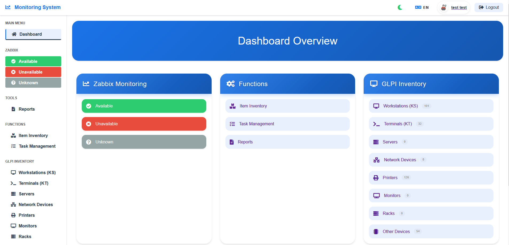
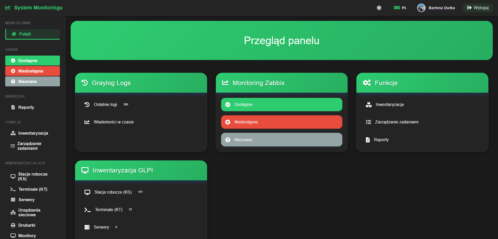
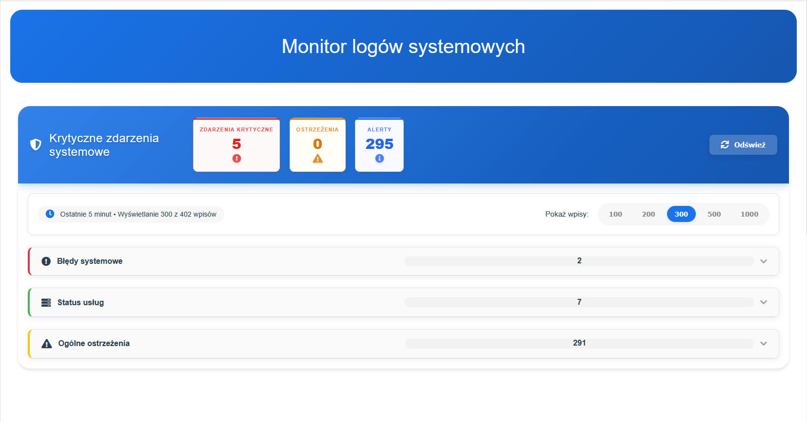
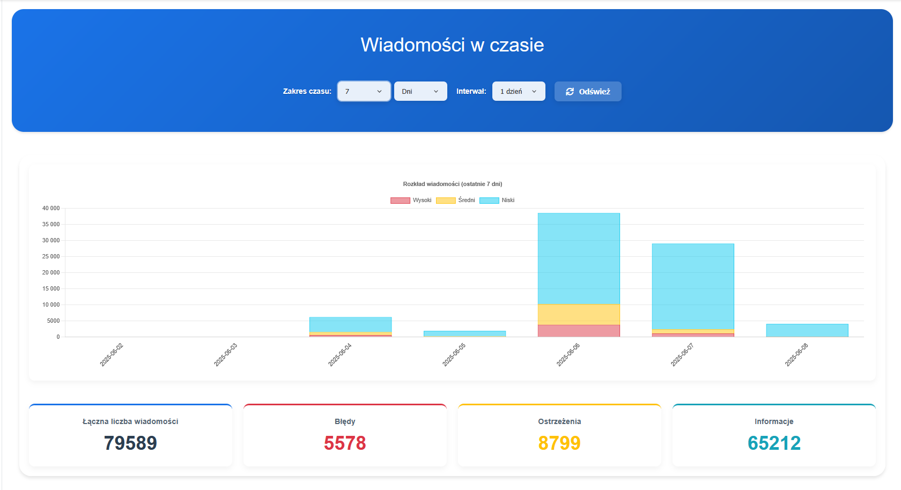
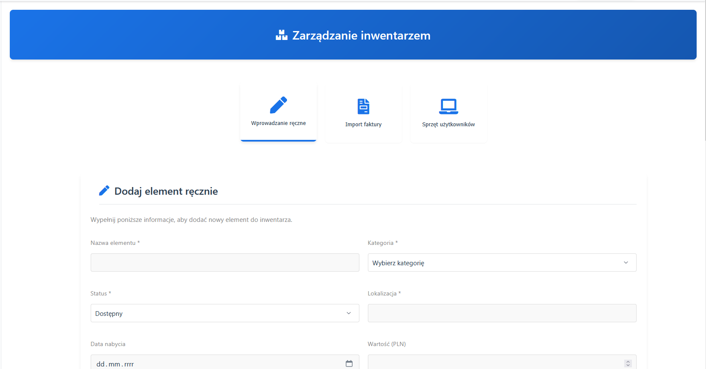
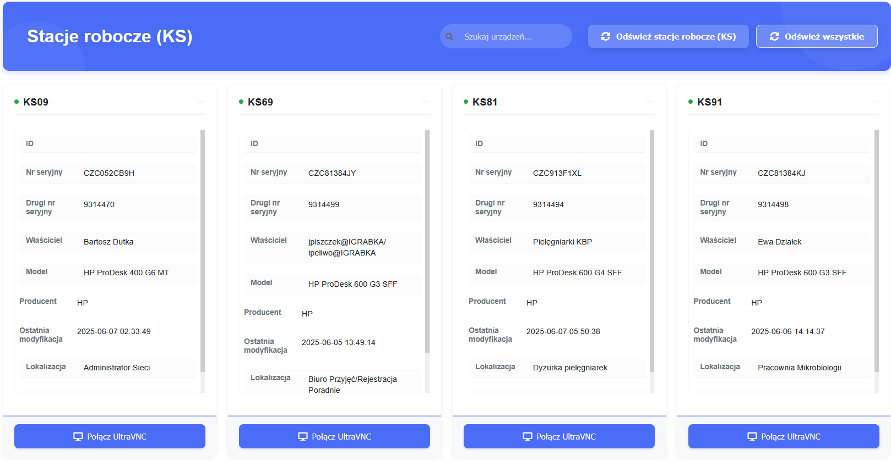
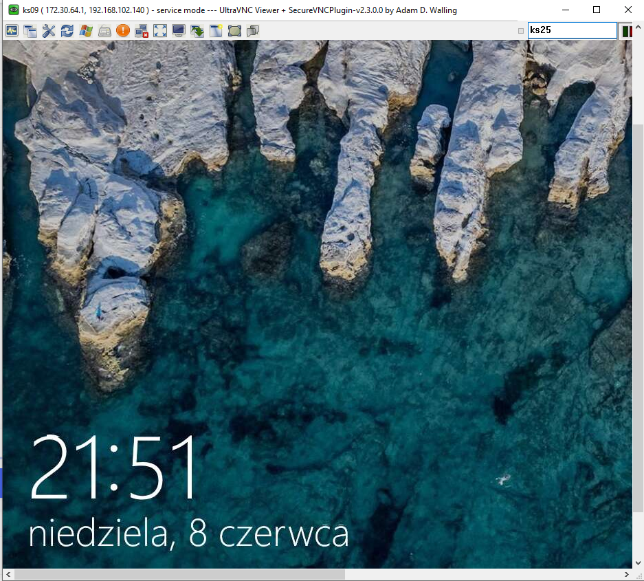
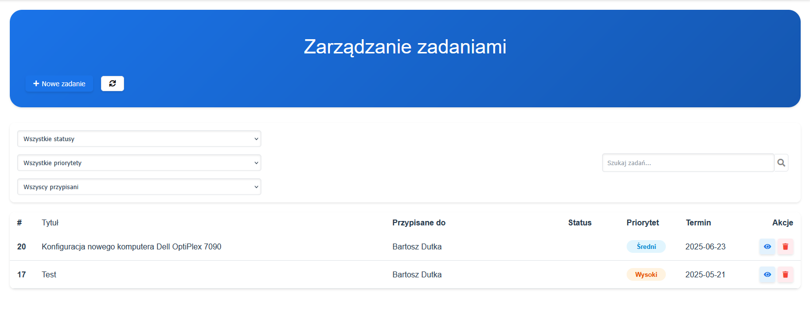
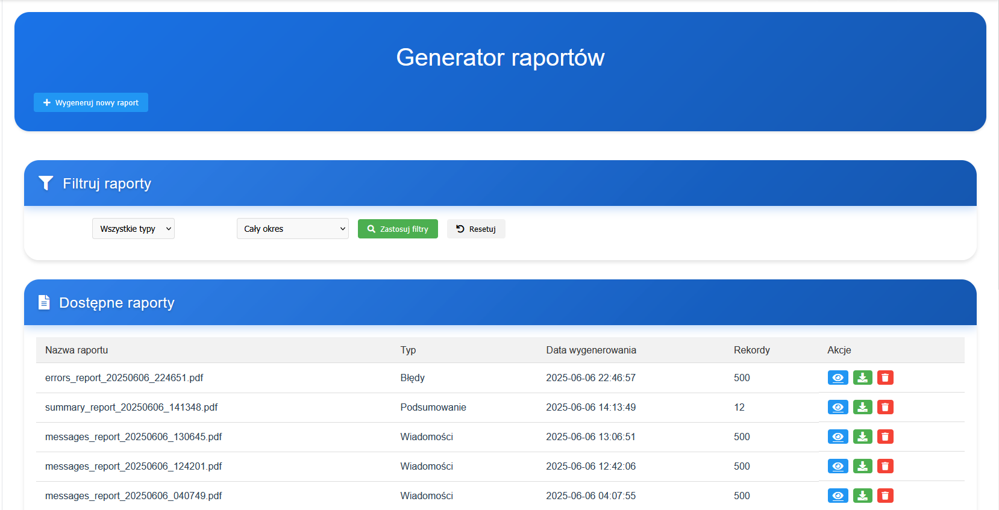

# Infrastructur Monitoring Platform

A web-based monitoring and administration system built with Flask. The application brings together infrastructure monitoring, system logs, inventory, tasks, reports, and user permissions in one interface.

## Overview

The system is designed for IT teams that need a single place to:

- monitor infrastructure data from Zabbix;
- search and review Graylog messages;
- browse GLPI inventory and available hosts;
- manage assets, workstations, tasks, roles, and permissions;
- generate and review operational reports;
- authenticate users locally or through LDAP;
- use a responsive light or dark interface.

## Screenshots

### Dashboard





### Monitoring and logs





### Inventory and workstations







### Tasks and reports





> The screenshots are representative views taken from the project's engineering documentation. They may contain sample or demonstration data.

## Technology stack

- **Backend:** Python, Flask
- **Database:** MySQL or MariaDB
- **Frontend:** Jinja templates, CSS, and JavaScript
- **Monitoring integrations:** Zabbix and Graylog
- **Asset management integration:** GLPI
- **Authentication:** local authentication with optional LDAP support
- **Reporting:** HTML/PDF/XLSX-oriented reporting modules
- **Testing:** pytest and pytest-flask

## Requirements

- Python 3.8 or newer (Python 3.10+ recommended)
- MySQL 5.7+ or MariaDB
- Node.js and npm
- Optional: `wkhtmltopdf` for PDF generation through `pdfkit`
- Access credentials for the integrations you want to enable

## Installation

### 1. Clone the repository

```bash
git clone https://github.com/BartoszDutka/Monitoring-System-.git
cd Monitoring-System-
```

### 2. Create and activate a virtual environment

Windows PowerShell:

```powershell
python -m venv venv
.\venv\Scripts\Activate.ps1
```

Linux/macOS:

```bash
python -m venv venv
source venv/bin/activate
```

### 3. Install dependencies

```bash
python -m pip install --upgrade pip
pip install -r requirements.txt
npm install
```

### 4. Configure environment variables

Create a local `.env` file from the provided template:

Windows PowerShell:

```powershell
Copy-Item .env.example .env
```

Linux/macOS:

```bash
cp .env.example .env
```

Set the values for your environment in `.env`:

```dotenv
ZABBIX_URL=https://your-zabbix.example/api_jsonrpc.php
ZABBIX_TOKEN=your_zabbix_token

GRAYLOG_URL=http://your-graylog.example:9000
GRAYLOG_USERNAME=your_username
GRAYLOG_PASSWORD=your_password

GLPI_URL=http://your-glpi.example/glpi
GLPI_USER_TOKEN=your_user_token
GLPI_APP_TOKEN=your_app_token

# Optional LDAP settings
LDAP_SERVER=ldap.example.com
LDAP_PORT=389
LDAP_BASE_DN=DC=example,DC=com
LDAP_DOMAIN=example.com
LDAP_SERVICE_USER=service_account
LDAP_SERVICE_PASSWORD=your_password
```

Do not commit `.env` or real credentials. The repository ignores local environment files by default.

### 5. Prepare the database

Create a MySQL/MariaDB database and make sure the configured user can access it. The application initializes its required tables and runtime directories during startup.

Example:

```sql
CREATE DATABASE monitoring_system;
```

## Running the application

Start the Flask application:

```bash
python app.py
```

Open [http://localhost:5000](http://localhost:5000) in a browser.

On first startup, the application prepares the required data structures, roles, permissions, and runtime directories. Configure the integrations in `.env` before using the related monitoring and inventory views.

## Project structure

```text
.
├── app.py                  # Flask application entry point
├── config.py               # Environment-based configuration
├── modules/
│   ├── admin/              # Administrative and permission tools
│   ├── auth/               # Authentication and LDAP support
│   ├── core/               # Database and permission foundations
│   ├── external/           # Zabbix, Graylog, and GLPI clients
│   ├── inventory/          # Inventory views and operations
│   ├── reports/            # Report generation and presentation
│   ├── tasks/              # Task management
│   └── utils/              # Shared utilities and translations
├── static/                 # CSS, JavaScript, and front-end assets
├── templates/              # Jinja templates
├── tests/                  # Automated tests
├── docs/screenshots/       # README screenshots
├── .env.example            # Safe configuration template
└── requirements.txt        # Python dependencies
```

## Testing

Run the test suite with:

```bash
pytest
```

## Troubleshooting

- **The application cannot connect to MySQL:** verify that the database service is running and that the credentials in `.env` are correct.
- **An integration view is empty:** check the relevant URL, token, and permissions in `.env`, then verify network access to the external service.
- **PowerShell blocks virtual-environment activation:** run `Set-ExecutionPolicy -ExecutionPolicy RemoteSigned -Scope CurrentUser` once, then activate the environment again.
- **PDF export fails:** install `wkhtmltopdf` and ensure it is available on the system `PATH`.

## Security

Keep API tokens, passwords, LDAP credentials, and database credentials outside version control. Use `.env.example` as the public template and replace every example value in your local `.env`.

## License

No license file is currently included. Contact the repository owner before redistributing or using the project in another product.
